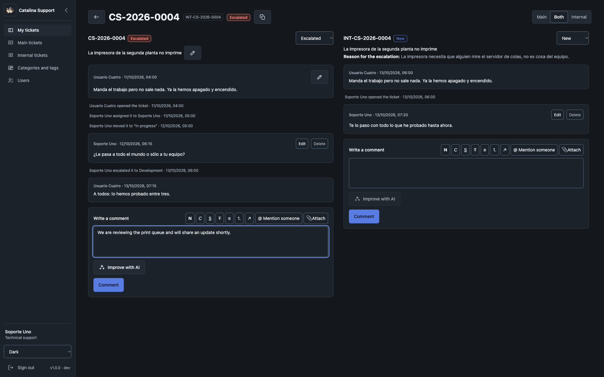
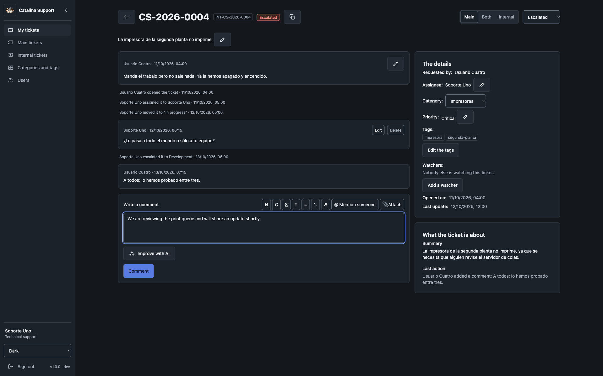

# Catalina Support

[English](README.md) · [Sitio web](https://catalina-support.com) · [Demo pública](https://demo.catalina-support.com) · [Apoyar en Ko-fi](https://ko-fi.com/juanky1990)

**Una mesa de ayuda de software libre y sin ruido para equipos que necesitan dos niveles claros de soporte.**

```text
usuario  →  soporte técnico (nivel 1)  →  desarrollo (nivel 2)
```

Catalina Support mantiene sencilla la conversación. El Usuario reporta, Soporte resuelve lo que
puede y sólo los casos filtrados —con su contexto— llegan a Desarrollo mediante un ticket interno
enlazado. Las dos conversaciones permanecen separadas, mientras el personal autorizado puede
revisarlas una junto a la otra.

La IA es útil, no decorativa: un motor local o configurable resume la situación actual y la última
acción de cada ticket, y ayuda a Soporte y Desarrollo a mejorar borradores. Las personas siguen
revisando, eligiendo y publicando todas las respuestas.

[Probar la demo](https://demo.catalina-support.com) · [Instalar localmente](#ejecutarlo-en-local) · [Desplegar en un servidor](#despliegue-en-producción)



El mismo ticket mantiene la ayuda de IA visible y revisable: **Resumen**, **Última acción** y
**Mejorar con IA** apoyan al equipo sin publicar nada automáticamente.



## Por qué Catalina Support

- Un flujo enfocado de dos niveles: Usuario → Soporte → Desarrollo.
- Tickets principales e internos con conversaciones independientes y vista simultánea.
- **Resumen** y **Última acción** redactados por IA, más mejora profesional de borradores.
- Motor local de IA, servidor compatible propio o proveedor externo.
- Categorías, etiquetas, prioridad, adjuntos, menciones, observadores y cronología auditable.
- Cuentas locales, Active Directory o Keycloak, un método de entrada a la vez.
- Plantillas de correo editables, marca de la instalación, zona horaria y dirección pública.
- Interfaz en español e inglés, ocho temas accesibles y pantallas adaptables.
- Contenedores para aplicación, base, buzón de pruebas y motor local de IA opcional.

## Probar la demo pública

Abre **[demo.catalina-support.com](https://demo.catalina-support.com)**. Es un entorno público y
compartido: no se garantiza su disponibilidad y sus datos se restauran periódicamente, por lo que
tus cambios no serán permanentes.

> **No introduzcas información personal, confidencial o de producción ni subas archivos
> sensibles.** Otras personas pueden ver el contenido compartido de la demo.

Todas las cuentas siguientes usan la contraseña **`123123123`**. La cuenta de Administrador no se
publica deliberadamente.

<details>
<summary>Mostrar las 11 cuentas de la demo</summary>

| Nombre | Correo | Papel |
| --- | --- | --- |
| Usuario Uno | `user1@demo.com` | Usuario |
| Usuario Dos | `user2@demo.com` | Usuario |
| Usuario Tres | `user3@demo.com` | Usuario |
| Usuario Cuatro | `user4@demo.com` | Usuario |
| Usuario Cinco | `user5@demo.com` | Usuario |
| Soporte Uno | `support1@demo.com` | Soporte |
| Soporte Dos | `support2@demo.com` | Soporte |
| Soporte Tres | `support3@demo.com` | Soporte |
| Desarrollador 1 | `dev1@demo.com` | Desarrollo |
| Desarrollador 2 | `dev2@demo.com` | Desarrollo |
| Desarrollador 3 | `dev3@demo.com` | Desarrollo |

</details>

Un buen primer recorrido:

1. Entra como `user1@demo.com` y crea un ticket desde **Mis tickets**.
2. Entra como `support1@demo.com`, ábrelo en **Tickets principales**, comenta, cambia su estado y
   escálalo con contexto útil.
3. Entra como `dev1@demo.com`, abre el ticket enlazado en **Tickets internos**, trabájalo y
   resuélvelo. El Usuario nunca ve esta conversación interna.

## Ejecutarlo en local

El camino recomendado comienza con una instalación vacía y recorre `/setup`. Los datos de ejemplo
son opcionales y se cargan después.

### Requisitos

- Git.
- Docker con Docker Compose en marcha.
- Un navegador.
- Internet en la primera ejecución para descargar imágenes, dependencias y el modelo de IA elegido.

No necesitas instalar Go, Node.js, PostgreSQL ni nginx en la máquina. Asignar al menos 4 GB de RAM
a Docker es un punto de partida práctico. El modelo local predeterminado descarga alrededor de
1,1 GB y no requiere GPU.

### 1. Clonar y levantar

```bash
git clone https://github.com/Catalina-Support/catalina-support.git catalina-support
cd catalina-support
docker compose -f dev.yml up -d --build
docker compose -f ai.yml up -d --build
docker compose -f dev.yml ps
```

El entorno espera a PostgreSQL, aplica el esquema y después inicia el backend. No carga datos de
ejemplo. Si la aplicación todavía no está lista, sigue la compilación:

```bash
docker compose -f dev.yml logs -f frontend backend
```

`Ctrl+C` deja de seguir los registros; los servicios continúan en marcha.

### 2. Completar el primer arranque

Abre **[http://127.0.0.1:11001](http://127.0.0.1:11001)**. Una base nueva abre `/setup`, no la
pantalla de entrada.

| Paso | Valor local |
| --- | --- |
| Instalación | Cualquier nombre e idioma; cambiar el idioma actualiza la interfaz inmediatamente |
| Entrada | **Local** |
| Ubicación | Tu zona horaria y `http://127.0.0.1:11001` como dirección pública |
| Correo saliente | Servidor `mail`, puerto `1025`, sin TLS ni credenciales; los demás valores editables ya aparecen completos |
| Inteligencia artificial | **Local**; abre el catálogo, acepta la licencia del modelo 1.5B, descárgalo, actívalo y ejecuta la prueba obligatoria |

La prueba de correo comprueba conexión y autenticación sin enviar un mensaje. La IA es obligatoria:
el asistente sólo termina después de una generación válida. Después entra con la cuenta de fábrica
de desarrollo **`admin` / `admin`**, crea usuarios y abre sus invitaciones en
**[Mailpit](http://127.0.0.1:11004)**.

La contraseña de desarrollo vive en `config/env/dev.env`. Producción usa su propio
`ADMIN_PASSWORD`; nunca uses `admin` allí. La cuenta de fábrica continúa siendo la puerta de
recuperación incluso cuando la instalación usa AD o Keycloak.

| Servicio | Dirección |
| --- | --- |
| Aplicación | [http://127.0.0.1:11001](http://127.0.0.1:11001) |
| Buzón de pruebas | [http://127.0.0.1:11004](http://127.0.0.1:11004) |
| Salud del backend | [http://127.0.0.1:11002/api/health](http://127.0.0.1:11002/api/health) |

### 3. Datos de ejemplo opcionales

Para cargar las mismas cuentas y tickets realistas que usa la demo:

```bash
docker compose -f dev.yml run --rm seed
```

Esto crea 11 cuentas, 25 tickets y 5 adjuntos. También **elimina los tickets, categorías,
etiquetas, cuentas `@demo.com` y adjuntos de desarrollo existentes, excepto la marca**. Ejecútalo
únicamente cuando quieras restaurar los ejemplos de forma consciente.

El seeder conserva la marca, idioma, dirección pública, correo, método de entrada, directorios, IA,
prefijo y reparto de una instalación terminada. Sobre una instalación incompleta prepara y sella una
demo local utilizable. Las 11 cuentas y su contraseña común están en
[Probar la demo pública](#probar-la-demo-pública); son credenciales exclusivamente de desarrollo.

### Parar y reanudar

```bash
docker compose -f dev.yml stop
docker compose -f dev.yml up -d
```

La base y los adjuntos se conservan. `docker compose -f dev.yml down` elimina contenedores y red,
pero conserva los volúmenes; añadir `-v` elimina también la base. No ejecutes `seed` simplemente
para volver a arrancar: reinicia el contenido de ejemplo.

### Si algo falla

| Síntoma | Qué comprobar |
| --- | --- |
| Docker no responde | Ejecuta `docker compose version` y comprueba que Docker esté en marcha; en Linux también necesitas acceso al daemon. |
| Un puerto está ocupado | Desarrollo usa 11001–11004. Detén el servicio en conflicto. |
| La web todavía no abre | Sigue `docker compose -f dev.yml logs -f frontend backend`; el arranque desacoplado no espera la compilación de Angular y Go. |
| El backend queda detenido tras migrar | Lee `docker compose -f dev.yml logs migrate`, corrige el error, ejecuta `docker compose -f dev.yml run --rm migrate` y vuelve a iniciar el backend. |
| Aparece `/setup` | Es lo esperado con una base nueva sin datos de ejemplo. |
| Las cuentas de ejemplo no entran | Carga los ejemplos y selecciona **Local** como método de entrada. La cuenta de fábrica siempre permite volver a cambiarlo. |
| El correo no llega a Mailpit | Confirma que `mail` esté en marcha y que SMTP apunte a `mail:1025`, sin TLS ni credenciales. |
| El catálogo no responde | Lee `docker compose -f ai.yml logs -f ai`; el administrador de IA debe estar levantado. |

Desarrollo publica sus puertos en todas las interfaces de la máquina. Úsalo sólo en una máquina y
red de confianza; no expongas este entorno como producción.

## Servicios opcionales de desarrollo

Levanta primero el entorno principal.

### IA local

```bash
docker compose -f ai.yml up -d
docker compose -f ai.yml logs -f ai
```

No se descarga ningún modelo automáticamente. `/setup` y **Configuración → motor de IA** muestran
fuente, licencia, tamaño, checksum y RAM antes de descargar el modelo 1.5B, 3B o 7B. El elegido se
puede activar, probar y eliminar desde la interfaz. Consulta la
[documentación del módulo de IA](docs/modules/ai.md).

### Active Directory de pruebas

```bash
docker compose -f active-directory.yml up -d
```

Es un directorio OpenLDAP con identidades de prueba, no el Active Directory real de una
organización. Su configuración y credenciales locales están en el
[módulo de autenticación](docs/modules/auth.md).

### Keycloak de pruebas

```bash
docker compose -f keycloak.yml up -d
docker compose -f keycloak.yml logs -f keycloak
```

Importa el reino de pruebas del repositorio y permite una vuelta OIDC local real. La configuración
y las credenciales están en el [módulo de autenticación](docs/modules/auth.md). Las credenciales de
ninguno de los dos directorios se usan en producción.

## Despliegue en producción

Producción es un despliegue administrado por quien opera el servidor, no el entorno de desarrollo
copiado a una máquina pública. Lee primero el [runbook completo](docs/ambientes.md): registra
supuestos propios del entorno y limitaciones conocidas que debes resolver en tu servidor.

Como mínimo:

1. Usa un servidor dedicado con Docker Compose, Bash, proxy inverso y un certificado HTTPS válido.
2. Crea `config/env/prod.env` desde `config/env/prod.env.example` con credenciales únicas para la
   base, `ADMIN_PASSWORD`, `TOKEN_SECRET` y secretos de administración y cifrado de IA. Nunca lo
   versiones.
3. Usa almacenamiento persistente para PostgreSQL, `_files`, `_logs` y los modelos locales de IA.
4. Construye y publica desde una revisión limpia. El script incluido publica en
   `/srv/catalina-support`; inspecciona y adapta ese supuesto antes de ejecutarlo.
5. Deja que el servicio de una sola ejecución aplique las migraciones aprobadas antes de iniciar la
   aplicación. Nunca descubre `*_dev.sql` ni ejecuta el seeder.
6. Completa `/setup` antes de exponer el servicio, configura SMTP real y sustituye todo valor de
   prueba.
7. Coloca la aplicación detrás de HTTPS, restringe los puertos directos y comprueba CSP y salud.
8. Copia y prueba la restauración tanto de la base como de los **adjuntos**. La copia incluida de la
   base no incluye `_files`.

Para el primer despliegue, construye e inicia el conjunto:

```bash
./scripts/prod-build.sh
```

Para las actualizaciones publicadas posteriores, usa `./scripts/update.sh` desde una rama `main`
limpia. Sólo admite un avance rápido desde `origin/main`, compila antes de interrumpir la versión
activa, crea y verifica un respaldo cuando hay migraciones pendientes e inicia la aplicación sólo
si terminan correctamente. `schema_migrations` guarda archivos y checksums SHA-256; una migración
publicada es inmutable. Verifica dominio, nginx, puertos, rutas y recuperación para tu instalación:
los archivos incluyen supuestos del servidor de referencia.

## Pruebas

Las pruebas unitarias se ejecutan en los contenedores de desarrollo:

```bash
docker compose -f dev.yml exec backend go test ./...
docker compose -f dev.yml exec backend go vet ./...
docker compose -f dev.yml exec frontend npm test -- --watch=false
```

La suite de navegador usa un entorno desechable aislado y nunca toca tu base de desarrollo:

```bash
docker compose -f tests.yml --profile directory down -v
docker compose -f tests.yml up -d --build database backend frontend mail
docker compose -f tests.yml run --rm e2e
docker compose -f tests.yml --profile directory down -v
```

Para incluir AD y Keycloak, añade `--profile directory` al segundo comando y agrega `ldap
keycloak`. Los informes, trazas y capturas quedan en `tests/e2e/resultados/`. Hay más detalle en la
[guía de pruebas locales](docs/prueba-local.md).

## Contribuir y seguridad

Catalina Support sigue **documentación antes que código**. Comienza por [AGENTS.md](AGENTS.md) y el
[índice de documentación](docs/README.md); después consulta la [guía de contribución](CONTRIBUTING.md)
y el [código de conducta](CODE_OF_CONDUCT.md). Las contribuciones sustanciales requieren el
[acuerdo de contribución](CLA.md).

Usa Issues para defectos y propuestas concretas, Discussions para preguntas abiertas y el reporte
privado de GitHub para vulnerabilidades. Consulta la [política de seguridad](SECURITY.md) y los
[canales de soporte](SUPPORT.md).

## Apoyar el proyecto

Si Catalina Support te ahorra tiempo, considera apoyar su desarrollo en
**[Ko-fi](https://ko-fi.com/juanky1990)**. Las donaciones son opcionales y no modifican las
funciones, las condiciones de soporte ni la licencia del software.

## Licencia

Catalina Support es software libre bajo la
[GNU Affero General Public License v3.0 únicamente](LICENSE). Puedes usarlo, estudiarlo, modificarlo
y redistribuirlo, también comercialmente. Si ofreces una versión modificada mediante una red, sus
usuarios deben poder obtener el código fuente correspondiente bajo la licencia.

Consulta también el [aviso de copyright](NOTICE), la [política de marca](TRADEMARKS.md) y los
[avisos de componentes de terceros](THIRD_PARTY_NOTICES.md).
