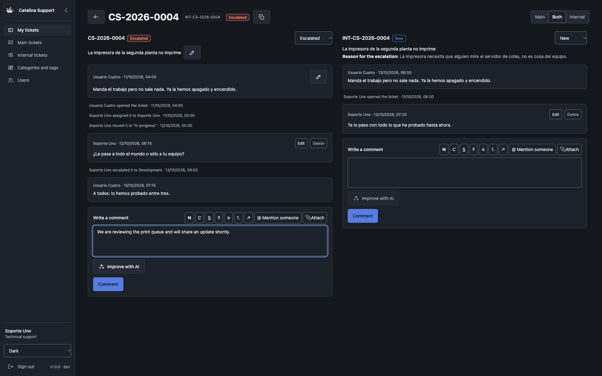

# Catalina Support

[English](README.md) · [Sitio web](https://catalina-support.com) · [Demo pública](https://demo.catalina-support.com) · [Donar](https://ko-fi.com/juanky1990)

**Una mesa de ayuda de software libre y sin ruido para equipos que necesitan dos niveles claros de soporte.**

```text
usuario  →  soporte técnico (nivel 1)  →  desarrollo (nivel 2)
```

El Usuario reporta un problema, Soporte resuelve lo que puede y sólo los casos filtrados llegan a
Desarrollo mediante un ticket interno enlazado. Las dos conversaciones permanecen separadas; el
personal autorizado puede compararlas lado a lado.

La IA ayuda sin decidir: un motor local o externo redacta el **Resumen** y la **Última acción** del
ticket, y ayuda a Soporte y Desarrollo a mejorar borradores. Las personas siguen revisando y
publicando cada respuesta.

[Probar la demo](https://demo.catalina-support.com) · [Ejecutarlo en local](#ejecutarlo-en-local) · [Desplegarlo](#producción)



## IA que ayuda, no decide

- **Resumen y Última acción** se redactan en segundo plano para cada ticket y se actualizan con
  cada movimiento, para que cualquiera entienda la situación en segundos.
- **Mejorar borradores** convierte una respuesta improvisada en una profesional, en el mismo editor.
  Soporte y Desarrollo pueden usar la propuesta o conservar su texto.
- **Local por defecto:** el modelo pequeño vive dentro del entorno. Un servidor compatible propio o
  un proveedor externo son opcionales, y el proveedor externo exige aceptar la privacidad.
- **Las personas deciden:** la IA nunca publica, cierra ni resuelve nada. Si el motor falla, los
  tickets siguen funcionando y los resúmenes se recuperan cuando vuelve.

## Todo lo que necesita una mesa de ayuda

- **Dos niveles, un flujo claro:** Usuario → Soporte → Desarrollo.
- **Tickets principales e internos** con conversaciones separadas y vista simultánea.
- **Tu forma de entrar:** cuentas locales, Active Directory o Keycloak, un método a la vez.
- **Detalles operativos:** categorías, etiquetas, prioridad, adjuntos, menciones y observadores.
- **A tu manera:** correos editables, marca, zona horaria y dirección pública.
- **Bilingüe y accesible:** español/inglés, ocho temas, fechas ISO y pantallas adaptables.
- **Autoalojado y libre:** AGPL-3.0-only, sin dependencia de un proveedor ni de la nube.

## Probar la demo

Abre **[demo.catalina-support.com](https://demo.catalina-support.com)**. Es un entorno público y
compartido: los datos se restauran periódicamente, la disponibilidad no está garantizada y los
cambios no son permanentes.

> **No introduzcas información personal, confidencial o de producción ni subas archivos sensibles.**

Las cuentas de demo usan la contraseña **`123123123`**. Empieza con `user1@demo.com`,
`support1@demo.com` o `dev1@demo.com`; la cuenta de administrador no se publica.

## Apoyar el proyecto

Si Catalina Support te ahorra tiempo, puedes apoyar su desarrollo en
**[Ko-fi](https://ko-fi.com/juanky1990)**. Las donaciones son opcionales y no modifican las funciones,
las condiciones de soporte ni la licencia.

## Ejecutarlo en local

Necesitas **Git**, **Docker con Compose**, un navegador e internet en la primera ejecución. No hace
falta instalar Go, Node.js, PostgreSQL ni nginx en la máquina. Unos 4 GB de RAM para Docker son un
buen punto de partida.

```bash
git clone https://github.com/Catalina-Support/catalina-support.git catalina-support
cd catalina-support
docker compose -f dev.yml up -d --build
docker compose -f ai.yml up -d --build
```

Abre **[http://127.0.0.1:11001](http://127.0.0.1:11001)**. Una base nueva abre `/setup`:

- elige entrada **Local**;
- usa tu zona horaria y `http://127.0.0.1:11001` como dirección pública;
- usa el servidor de correo `mail`, puerto `1025`, sin TLS ni credenciales;
- elige la IA local, descarga un modelo y ejecuta la prueba obligatoria.

La prueba de correo envía un mensaje real; léelo en **[Mailpit](http://127.0.0.1:11004)**. Termina el
asistente y entra con **`admin` / `admin`**.

Para cargar las 11 cuentas y los 25 tickets de ejemplo:

```bash
docker compose -f dev.yml run --rm seed-es   # o seed-en
```

El seeder reinicia los tickets y las cuentas de desarrollo. Detén el entorno con
`docker compose -f dev.yml down`; `down -v` elimina también la base.

Para **aceleración NVIDIA**, usa el overlay en lugar del comando normal de IA:

```bash
docker compose -f ai.yml -f ai-nvidia.yml up -d --build
```

En Linux hace falta NVIDIA Container Toolkit; en Windows, Docker Desktop con backend WSL2. La CPU
funciona sin GPU.

Más detalle: [primer arranque](docs/primer-arranque.md) y [pruebas locales](docs/prueba-local.md).

## Producción

Producción es un despliegue administrado por quien opera el servidor, no el entorno de desarrollo
expuesto a internet. Lee primero la **[guía de despliegue](docs/ambientes.md)**. Como mínimo
necesitas un servidor dedicado, `config/env/prod.env`, HTTPS, almacenamiento persistente, SMTP real y
copias probadas de la base **y** de los adjuntos.

```bash
./scripts/prod-build.sh     # construir, publicar y desplegar
./scripts/update.sh         # actualizaciones posteriores desde main limpio
```

Completa `/setup` antes de exponer el servicio y sustituye todos los valores de prueba. La guía
recoge los supuestos del servidor, puertos, nginx/TLS y recuperación.

## Pruebas

Las pruebas unitarias se ejecutan en los contenedores de desarrollo; la suite de navegador usa un
entorno aislado y desechable. Los comandos y la cobertura están en la
**[guía de pruebas locales](docs/prueba-local.md)**.

## Contribuir y seguridad

Catalina Support sigue **documentación antes que código**. Lee [AGENTS.md](AGENTS.md), el
[índice de documentación](docs/README.md), la [guía de contribución](CONTRIBUTING.md) y el
[código de conducta](CODE_OF_CONDUCT.md). Las contribuciones sustanciales requieren el
[acuerdo de contribución](CLA.md).

Usa Issues para defectos y propuestas, Discussions para preguntas abiertas y el reporte privado de
GitHub para vulnerabilidades. Consulta [SECURITY.md](SECURITY.md) y [SUPPORT.md](SUPPORT.md).

## Licencia

Catalina Support es software libre bajo la
**[GNU Affero General Public License v3.0 únicamente](LICENSE)**. Puedes usarlo, estudiarlo,
modificarlo y redistribuirlo, también comercialmente. Si ofreces una versión modificada mediante una
red, sus usuarios deben poder obtener el código fuente correspondiente bajo la licencia.

Consulta también [NOTICE](NOTICE), [TRADEMARKS.md](TRADEMARKS.md) y
[THIRD_PARTY_NOTICES.md](THIRD_PARTY_NOTICES.md).
