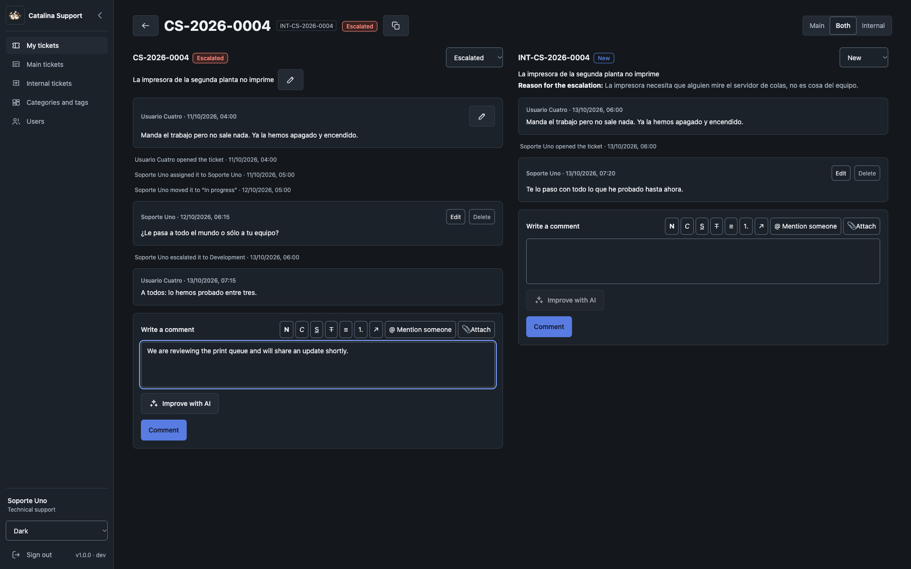

# Catalina Support

[Español](README.es.md) · [Website](https://catalina-support.com) · [Live demo](https://demo.catalina-support.com) · [Donate](https://ko-fi.com/juanky1990)

**A quiet, open-source help desk for teams that need two clear support levels—not enterprise clutter.**

```text
requester  →  technical support (level 1)  →  development (level 2)
```

Users report an issue, Support resolves what it can, and only the filtered cases reach Development
through a linked internal ticket. The two conversations stay separate; authorized staff can compare
them side by side.

AI helps without taking over: a local or external engine writes the ticket **Summary** and **Last
action**, and helps Support and Development improve drafts. People still review and publish every
response.

[Try the demo](https://demo.catalina-support.com) · [Run it locally](#run-it-locally) · [Deploy it](#production)



## Why Catalina Support

- **Two levels, one clear flow:** User → Support → Development.
- **Main and internal tickets** with separate conversations and a side-by-side view.
- **AI that helps, not decides:** summaries, last action and draft improvement, always reviewed.
- **Your sign-in:** local accounts, Active Directory or Keycloak—one method at a time.
- **Useful details:** categories, tags, priority, attachments, mentions and watchers.
- **Yours to shape:** editable emails, branding, time zone and public URL.
- **Bilingual and accessible:** Spanish/English, eight themes, ISO dates and responsive screens.
- **Free software:** self-hosted, AGPL-3.0-only, with no lock-in.

## Try it

Open **[demo.catalina-support.com](https://demo.catalina-support.com)**. It is a shared public
environment: data is restored periodically, availability is not guaranteed, and changes are not
permanent.

> **Do not enter personal, confidential or production information, or upload sensitive files.**

Demo accounts use the password **`123123123`**. Start with `user1@demo.com`, `support1@demo.com` or
`dev1@demo.com`; the administrator account is not published.

## Support the project

If Catalina Support saves you time, you can support its development on
**[Ko-fi](https://ko-fi.com/juanky1990)**. Donations are optional and do not change features,
support terms or the license.

## Run it locally

You need **Git**, **Docker with Compose**, a browser and internet access on the first run. You do not
need Go, Node.js, PostgreSQL or nginx on the host. About 4 GB of RAM for Docker is a good start.

```bash
git clone https://github.com/Catalina-Support/catalina-support.git catalina-support
cd catalina-support
docker compose -f dev.yml up -d --build
docker compose -f ai.yml up -d --build
```

Open **[http://127.0.0.1:11001](http://127.0.0.1:11001)**. A new database opens `/setup`:

- choose **Local** sign-in;
- use your time zone and `http://127.0.0.1:11001` as the public URL;
- use mail host `mail`, port `1025`, without TLS or credentials;
- choose the local AI, download a model and run the required test.

The email test sends a real message; read it in **[Mailpit](http://127.0.0.1:11004)**. Finish setup,
then sign in with **`admin` / `admin`**.

To load the 11 demo accounts and 25 sample tickets:

```bash
docker compose -f dev.yml run --rm seed-es   # or seed-en
```

The seeder resets development tickets and accounts. Stop with `docker compose -f dev.yml down`;
`down -v` also removes the database.

For **NVIDIA acceleration**, use the overlay instead of the plain AI command:

```bash
docker compose -f ai.yml -f ai-nvidia.yml up -d --build
```

Linux needs the NVIDIA Container Toolkit; Windows needs Docker Desktop with the WSL2 backend. CPU
works without a GPU.

More detail: [first start](docs/primer-arranque.md) and [local testing](docs/prueba-local.md).

## Production

Production is an operator-managed deployment, not the development stack exposed to the internet.
Read the complete **[deployment runbook](docs/ambientes.md)** first. At minimum, you need a dedicated
host, `config/env/prod.env`, HTTPS, persistent storage, real SMTP and tested backups of the database
**and** attachments.

```bash
./scripts/prod-build.sh     # build, publish and deploy
./scripts/update.sh         # later updates from a clean main
```

Complete `/setup` before exposing the service and replace every test value. The runbook records the
server assumptions, ports, nginx/TLS and recovery details.

## Tests

Unit tests run inside the development containers; the browser suite uses an isolated, disposable
stack. Commands and coverage are in the **[local testing guide](docs/prueba-local.md)**.

## Documentation

| Topic | Document |
| --- | --- |
| Documentation index | [docs/en/README.md](docs/en/README.md) |
| First start | [docs/en/primer-arranque.md](docs/en/primer-arranque.md) |
| AI engine | [docs/en/modules/ai.md](docs/en/modules/ai.md) |
| Email | [docs/en/modules/mail.md](docs/en/modules/mail.md) |
| Authentication | [docs/en/modules/auth.md](docs/en/modules/auth.md) |
| Tickets | [docs/en/modules/tickets.md](docs/en/modules/tickets.md) |
| Users | [docs/en/modules/users.md](docs/en/modules/users.md) |
| Settings | [docs/en/modules/settings.md](docs/en/modules/settings.md) |
| Dashboard | [docs/en/modules/dashboard.md](docs/en/modules/dashboard.md) |
| Architecture | [docs/en/arquitectura.md](docs/en/arquitectura.md) |
| Interface and experience | [docs/en/interfaz-y-experiencia.md](docs/en/interfaz-y-experiencia.md) |
| Purpose and scope | [docs/en/propósito-y-alcance.md](docs/en/propósito-y-alcance.md) |
| Users and permissions | [docs/en/usuarios-y-permisos.md](docs/en/usuarios-y-permisos.md) |
| Flows | [docs/en/flujos.md](docs/en/flujos.md) |
| Local testing | [docs/en/prueba-local.md](docs/en/prueba-local.md) |
| Environments and deployment | [docs/en/ambientes.md](docs/en/ambientes.md) |
| Shared environments | [docs/en/entornos-compartidos.md](docs/en/entornos-compartidos.md) |
| Open project | [docs/en/proyecto-abierto.md](docs/en/proyecto-abierto.md) |
| QA report 1.0.1 | [docs/informe_qa_20261105.md](docs/informe_qa_20261105.md) |
| Documentación en español | [docs/es/README.md](docs/es/README.md) |

## Contributing and security

Catalina Support follows **documentation before code**. Read [AGENTS.md](AGENTS.md), the
[documentation index](docs/README.md), the [contribution guide](CONTRIBUTING.md) and the
[code of conduct](CODE_OF_CONDUCT.md). Substantial contributions require the
[Contributor License Agreement](CLA.md).

Use Issues for defects and proposals, Discussions for open questions, and GitHub's private security
reporting for vulnerabilities. See [SECURITY.md](SECURITY.md) and [SUPPORT.md](SUPPORT.md).

## License

Catalina Support is free software under the
**[GNU Affero General Public License v3.0 only](LICENSE)**. You may use, study, modify and
redistribute it, including commercially. If you provide a modified version over a network, its users
must be able to obtain the corresponding source code under the license.

See also [NOTICE](NOTICE), [TRADEMARKS.md](TRADEMARKS.md) and
[THIRD_PARTY_NOTICES.md](THIRD_PARTY_NOTICES.md).
